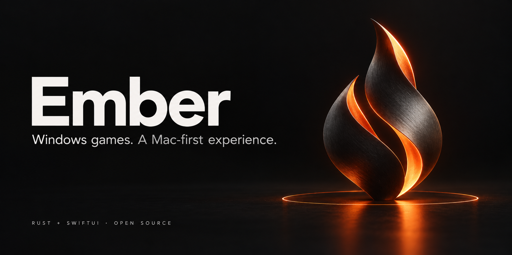

<p align="center">
  
</p>

<p align="center">
  <strong>A native home for Windows Steam games on your Mac.</strong>
</p>

<p align="center">
  <a href="https://github.com/QuantumCoderSys/Ember/actions/workflows/ci.yml"></a>
  
  
  
  <a href="LICENSE"></a>
</p>

---

Ember is an independent, open-source macOS project focused on **Windows Steam gaming on Apple silicon**. Its goal is to make a carefully tested selection of games easy to install, configure, and launch, with a native SwiftUI interface and a small Rust core.

The focus is practical: tested settings per game, reproducible performance measurements, and runtime updates you can roll back. Ember will build on existing compatibility technology rather than recreate Windows support from scratch.

> **Early development.** This repository currently contains a buildable app scaffold and a working Rust–Swift bridge. It does **not** install Steam, download Wine, or launch Windows games yet. No games or performance improvements have been validated.

## Built for a focused job

| Native on the outside | Rust underneath | Evidence before promises |
| --- | --- | --- |
| SwiftUI navigation, standard Mac settings, keyboard shortcuts, and system appearance. | A statically linked core for runtime state and validated Steam game-profile data. | An empty initial catalog; future compatibility claims will require real gameplay and benchmark results. |

## What works today

- Native library, runtime, and game-profile screens.
- Real core version, host architecture, and bridge status from Rust.
- A small C ABI with versioned JSON and explicit allocation ownership.
- Validated profile catalogs that reject invalid IDs, duplicate entries, and unsupported schemas.
- Rust tests, a Swift-to-Rust integration test, and macOS CI.
- One-command local build and `.app` launch.

## Build and run

You need a Mac running **macOS 14 or later**, Xcode Command Line Tools with **Swift 6+**, and stable **Rust 1.85+** with Cargo, rustfmt, and Clippy. Apple silicon is the product target. Local builds use the host architecture; universal binaries are not configured.

Install [Xcode Command Line Tools](https://developer.apple.com/xcode/resources/) and [Rust](https://www.rust-lang.org/tools/install) if needed, then:

```sh
git clone https://github.com/QuantumCoderSys/Ember.git
cd Ember
./script/build_and_run.sh
```

The script builds Rust first, links it into the Swift app, stages `dist/Ember.app`, applies a local development signature, and opens the app. It does not install a compatibility runtime or change your Steam installation.

```sh
./script/build.sh                  # Build without launching
./script/check.sh                  # Format, lint, Rust tests, build, Swift tests
./script/build_and_run.sh --verify # Launch and verify the process
./script/build_and_run.sh --debug  # Launch under LLDB
./script/build_and_run.sh --logs   # Launch and stream process logs
```

Run Rust before building directly in SwiftPM: the Swift package links against `.build/rust/debug/libember_ffi.a`. The scripts handle that ordering automatically. The `.codex` environment also supplies a Run action when this repository is opened as a Codex project.

**Build compatibility:** macOS 14 is the configured deployment target, not a tested compatibility guarantee. Some Homebrew Rust bottles include a standard library targeting the build host's newer macOS version. Use the official rustup toolchain for builds intended for older systems; setting `MACOSX_DEPLOYMENT_TARGET` alone cannot lower the target of a prebuilt standard library. Release compatibility testing is still ahead.

## Architecture

```text
SwiftUI app
    │
    ▼
EmberKit · Swift models and decoding
    │  C ABI · owned UTF-8 JSON
    ▼
ember-ffi · allocation and panic boundary
    │
    ▼
ember-core · state and profile validation

Next: verified runtime installation → Windows Steam → game launch
```

| Path | Purpose |
| --- | --- |
| `macOS/` | Swift package, native interface, C header, and bridge tests |
| `rust/ember-core/` | Core state and validated Steam profile models |
| `rust/ember-ffi/` | Static library exposing the core to Swift |
| `profiles/` | Versioned game catalog, initially empty |
| `script/` | Reproducible build, test, and launch commands |
| `docs/` | Architecture, roadmap, and artwork provenance |

Read the [architecture notes](docs/architecture.md) for bridge ownership and build details.

## Roadmap

- [x] Rust workspace and native SwiftUI scaffold.
- [x] Working bridge, integration tests, and local app bundle.
- [ ] Select a macOS-compatible Wine distribution and graphics backend; review their distribution terms.
- [ ] Add runtime downloads with integrity verification, version pinning, and rollback.
- [ ] Install and launch Windows Steam in an isolated environment.
- [ ] Discover installed games and launch them through Steam.
- [ ] Validate an initial catalog of 5–10 games on named Mac configurations.
- [ ] Add measured game profiles, launch diagnostics, and performance reports.
- [ ] Sign and notarize distributable releases.

See the [roadmap](docs/roadmap.md) for the criteria behind these milestones.

## Contributing

Ember is at its foundation stage. Contributions that improve reproducible builds, runtime integration, or documented game testing are welcome. Start with [CONTRIBUTING.md](CONTRIBUTING.md).

## License and acknowledgments

Ember's original code is [MIT licensed](LICENSE). Steam, games, and any future bundled compatibility components retain their own licenses. No Steam or Wine binaries are included in this repository.

This project builds on the work of the broader Wine and Mac gaming communities. Ember is not affiliated with Valve, Apple, or CodeWeavers. Steam is a trademark of Valve Corporation.

The README banner is AI-generated conceptual brand artwork, not a product screenshot. Its generation prompt is recorded in [docs/assets/README.md](docs/assets/README.md).
